<div align="center">

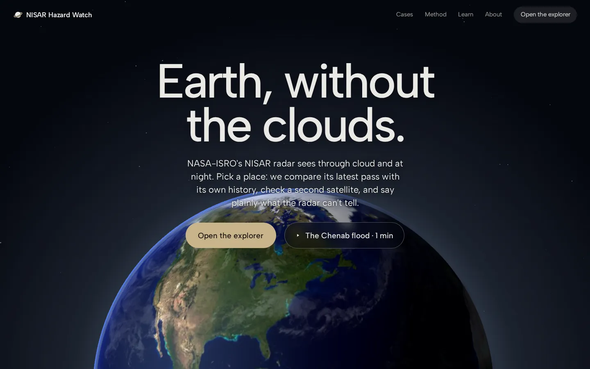

# NISAR Hazard Watch

**Earth, without the clouds.**

NISAR Hazard Watch is a **radar evidence explorer** for NASA-ISRO's NISAR radar, which sees the
ground through cloud and at night: pick a place and it shows whether the radar echo there changed
beyond that place's own normal range. It checks that against a second satellite and says plainly
what the radar can't tell: no forecasts, no probabilities, no causes.

[](https://nova-frontier-frontend.vercel.app)
[](https://nova-frontier-frontend.vercel.app/method)

[](https://github.com/NASA-NOVA-FRONTIER/nova-frontier-frontend/actions/workflows/ci.yml)


**[Live demo](https://nova-frontier-frontend.vercel.app)** ·
**[Cases](https://nova-frontier-frontend.vercel.app/cases)** ·
**[Method](https://nova-frontier-frontend.vercel.app/method)** ·
**[Backend](https://github.com/NASA-NOVA-FRONTIER/nova-frontier-backend)** ·
**[Model](https://github.com/NASA-NOVA-FRONTIER/nova-frontier-model)**

</div>

> [!IMPORTANT]
> **Prototype status (design v8).** The NISAR frames, the satellite passes and every number in the
> measured cases are **real**: frames and passes come from NASA's NISAR Observation Plan, case
> numbers and layer images from the science team's reports
> ([NASA-NOVA-FRONTIER/nova-frontier-model](https://github.com/NASA-NOVA-FRONTIER/nova-frontier-model)). Some things are still
> **demo**: the per-pass band chart series and the pass timeline dates of the measured cases. A live
> question on any other land is answered by the backend with measured radar (**Real**, about one to
> two and a half minutes on a fresh area). Every value carries a **Real** / **Demo** / **To fill** chip in the
> app; Demo and To fill chips can't be hidden. See
> [What is real and what is demo](#what-is-real-and-what-is-demo).

## Contents

- [Architecture](#architecture)
- [Pages](#pages)
- [The explorer](#the-explorer)
- [Measured cases](#measured-cases)
- [Data sources and where they are fetched](#data-sources-and-where-they-are-fetched)
- [What is real and what is demo](#what-is-real-and-what-is-demo)
- [Guided story, onboarding, Nova and reports](#guided-story-onboarding-nova-and-reports)
- [Getting started](#getting-started)
- [Configuration](#configuration)
- [Testing](#testing)
- [Deploying](#deploying)
- [Project structure](#project-structure)
- [What we don't claim](#what-we-dont-claim)
- [Branches, pull requests and protection](#branches-pull-requests-and-protection)
- [Contributing](#contributing)
- [Credits and license](#credits-and-license)

## Architecture

How a question travels: the browser calls the backend on Railway, which plans the scenes and hands
the job to the ML gateway on Modal; the gateway reads NISAR data from NASA archives and the radar
layers come back to the globe.

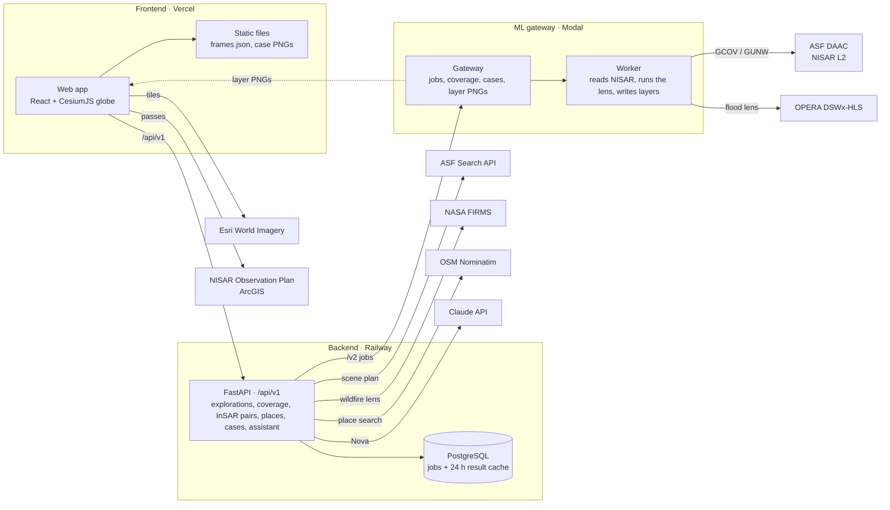

The detailed drawing, with every box traced to the code, is
[`docs/architecture/architecture.png`](docs/architecture/architecture.png) (source
`docs/architecture/architecture.html`, rendered with `pnpm diagram`).

## Pages

| Path       | Page                                                                                                                                                                                              |
| ---------- | ------------------------------------------------------------------------------------------------------------------------------------------------------------------------------------------------- |
| `/`        | Landing: one scroll story over a three.js Earth, a drag-to-compare radar vs. optical view, the pipeline, the cases carousel, where the method fails, sources                                      |
| `/explore` | The explorer: a CesiumJS globe with the measured cases and every NISAR frame                                                                                                                      |
| `/cases`   | The measured cases as cards, filterable by question                                                                                                                                               |
| `/method`  | How it works: the NISAR satellite, the Qadirabad sequence, six steps, the band chart, the lenses, what the echo says, wavelengths, interferometry, works / fails, experimental models, colour key |
| `/learn`   | Radar basics: an interactive wave (wavelength, polarization, incidence angle) and the challenge's learning resources                                                                              |
| `/about`   | The team (Nova Frontier) and project links                                                                                                                                                        |
| `/report`  | `?case=<id>` (a measured case) or `?exploration=<id>` (a live answer): a printable one-page report                                                                                                |

Shareable explorer links: `/explore?case=qadirabad` opens a measured case;
`/explore?frame=47-3` (optionally `&lens=<id>`) asks a live question on a NISAR frame;
`/explore?bbox=-74.78,2.87,-74.73,2.91` or `?geo=lon,lat_lon,lat_…` asks it on a drawn area;
`&lens=insar&pair=<GUNW granule>[&coherence=0.35]` measures one interferometric pair;
`/explore?story=1` starts the guided story. Old `/?frame=` links still open the explorer.

<table>
  <tr>
    <td width="50%">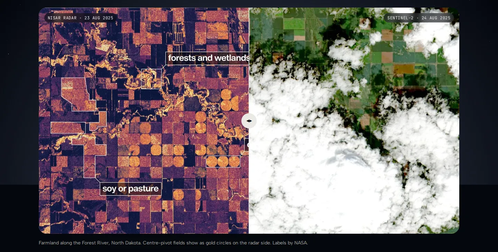</td>
    <td width="50%">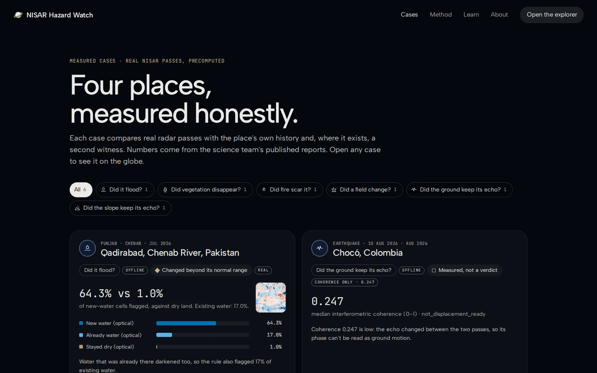</td>
  </tr>
  <tr>
    <td align="center"><b>Same fields, one day apart</b><br><sub>NISAR radar vs. Sentinel-2 over North Dakota</sub></td>
    <td align="center"><b>Cases</b><br><sub>The measured cases, filterable by question</sub></td>
  </tr>
  <tr>
    <td width="50%">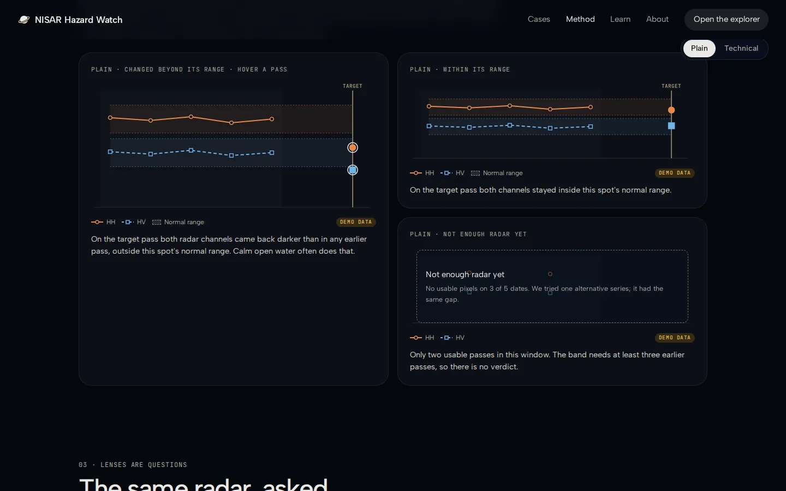</td>
    <td width="50%">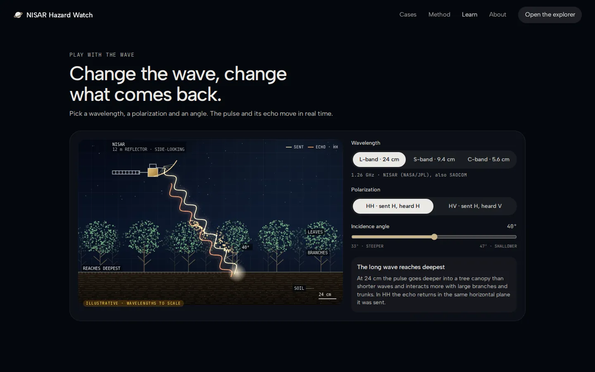</td>
  </tr>
  <tr>
    <td align="center"><b>Method</b><br><sub>Reading the band chart (demo series)</sub></td>
    <td align="center"><b>Learn</b><br><sub>Change the wave, change what comes back</sub></td>
  </tr>
</table>

## The explorer

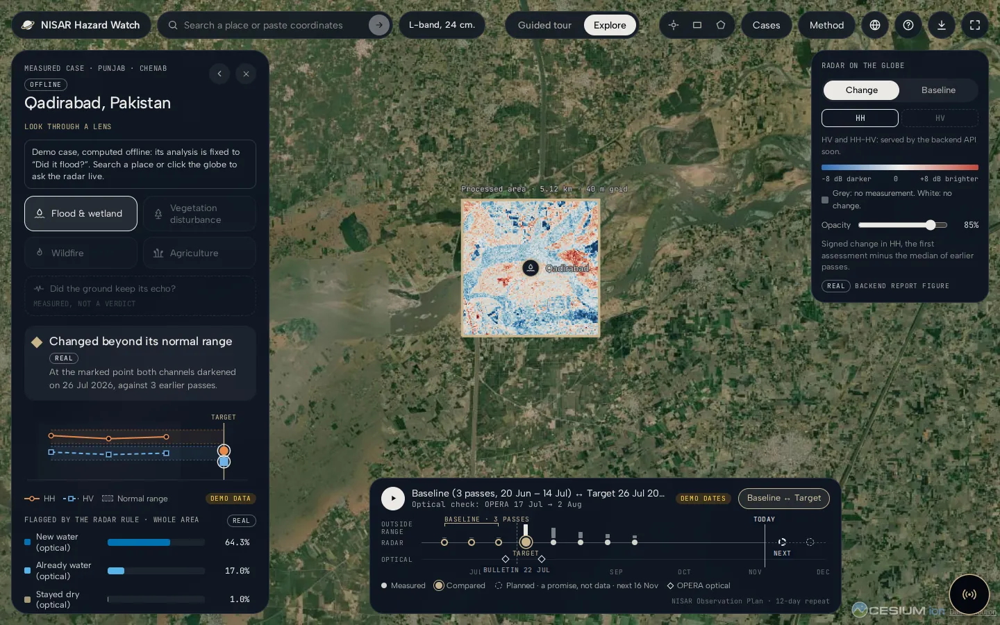

<p align="center"><b>A measured case:</b> Qadirabad, Pakistan. The verdict, the real contrast bars and the report's change crop on the globe; the band chart and timeline dates are labelled demo.</p>

- **Start card:** the measured cases and the frames snapshot status; case markers on the globe.
- **Case panel:** the question as lens chips ("Did it flood?", "Did the ground keep its echo?", …), the
  verdict in plain words, the band chart, the contrast bars against the optical witness, a quality
  strip and "More information".
- **More information:** a large sheet with the five beats in full (question, measurement, verdict,
  second witness, limits), the report figure, a drag-to-split compare tile, Plain / Technical
  modes and sources.
- **Layer dock:** the report's change or baseline crop draped on the globe, with an opacity slider.
- **Pass timeline:** baseline, target, measured and planned passes, the optical lane and the next
  planned pass.
- **Live question:** click any land (or search a place or coordinates) to place a 10 × 10 km
  square; the bar says "Square placed" and nothing runs yet. "Use this square" opens the confirm
  panel: what the radar should look for (Earthquake, Wildfire, Deforestation, Flood), the real
  passes it will read and "Start analysis". The answer comes from the backend: a
  progress window with a countdown and NASA facts, then the verdict, the target pass against the
  normal range, the whole-area bars, the quality strip, the measured layers on the globe and the
  real pass dates. On Earthquake (the InSAR lens) the user first picks one of the NISAR interferometric pairs over the spot and a coherence threshold; the answer is the pair's coherence and wrapped phase on the globe, labelled a measurement, never a verdict, with displacement always stated as not reported. On the wildfire lens an "Independent fire context" block from NASA FIRMS sits
  apart from the radar (counts and dates of active-fire detections, never a cause or a burned
  area), and says so when it is missing. "Keep exploring" lets the job run in the background; the band label reads
  "L-band, 24 cm.", the band every answer uses.
- **Guided tour / Explore switch:** the guided story on the Chenab flood (see below).
- **Nova:** the round button bottom right opens a chat that explains what is on screen (Claude
  when the backend has a key, rules otherwise; see below).
- **Download menu:** a PNG of the globe, the case's timeline as JSON or CSV, and the PDF report.
- **Help menu:** replay the quick tour, start the story, pages, "Show REAL labels" (hides only Real
  chips), reduce motion.

<table>
  <tr>
    <td width="50%">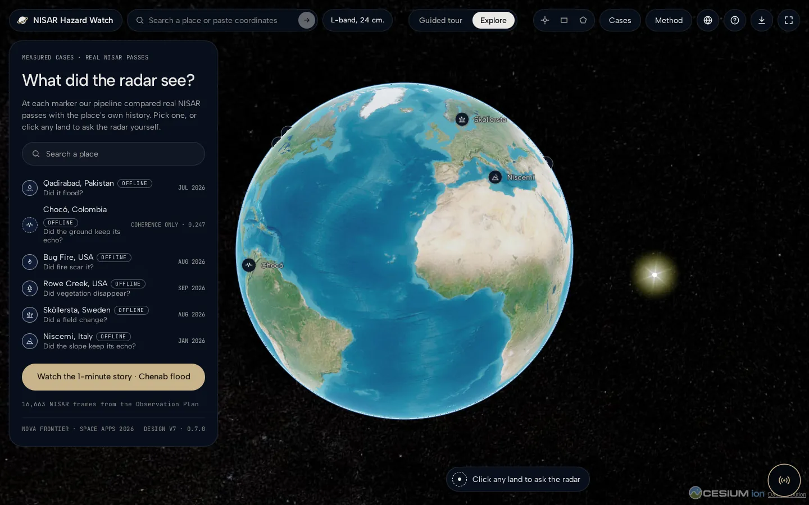</td>
    <td width="50%">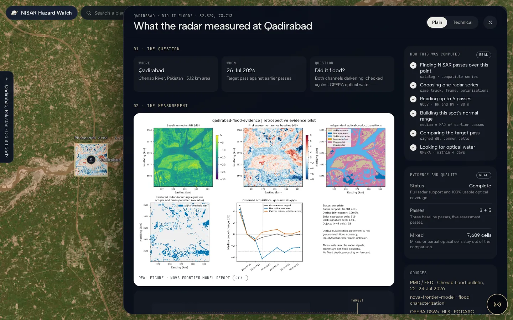</td>
  </tr>
  <tr>
    <td align="center"><b>What did the radar see?</b><br><sub>The start card and case markers</sub></td>
    <td align="center"><b>More information</b><br><sub>The real report figure, how it was computed, evidence, sources</sub></td>
  </tr>
  <tr>
    <td width="50%">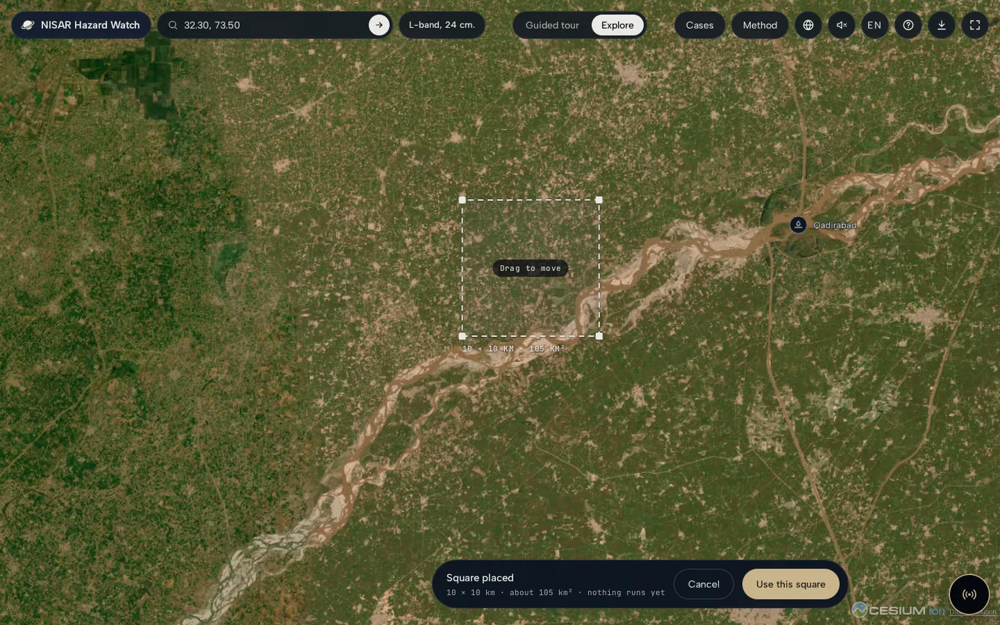</td>
    <td width="50%">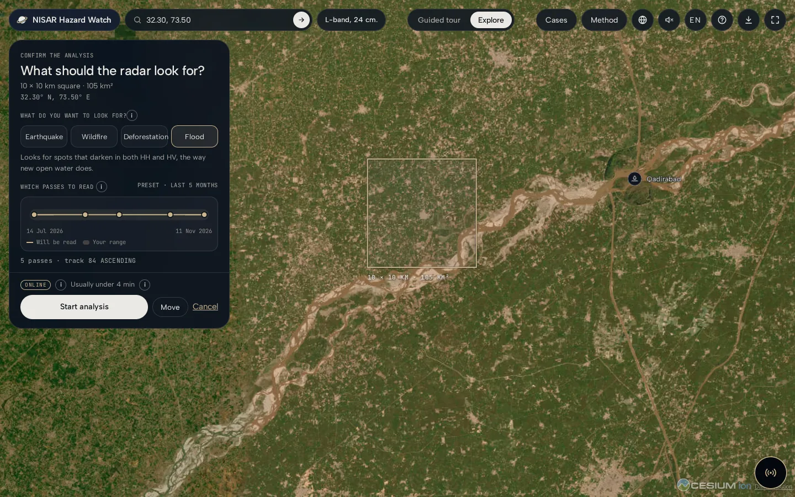</td>
  </tr>
  <tr>
    <td align="center"><b>Place a square</b><br><sub>Nothing runs until you confirm</sub></td>
    <td align="center"><b>Confirm the analysis</b><br><sub>The phenomenon and the real passes to read</sub></td>
  </tr>
</table>

<table>
  <tr>
    <td width="33%">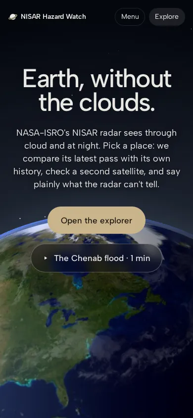</td>
    <td width="33%">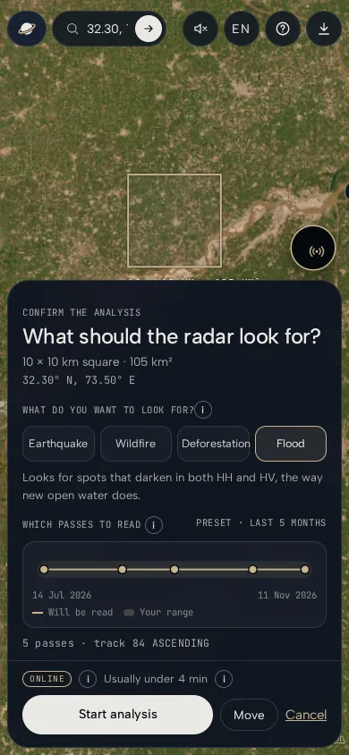</td>
    <td width="33%">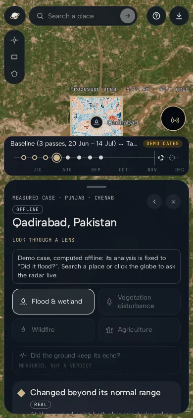</td>
  </tr>
  <tr>
    <td align="center"><b>On a phone</b><br><sub>Landing at 390 px</sub></td>
    <td align="center"><b>On a phone</b><br><sub>The confirm panel at 390 px</sub></td>
    <td align="center"><b>On a phone</b><br><sub>The Qadirabad case at 390 px</sub></td>
  </tr>
</table>

## Measured cases

All numbers live in `src/features/cases/cases.ts`, copied from the
[nova-frontier-model](https://github.com/NASA-NOVA-FRONTIER/nova-frontier-model) reports. There is
exactly one demo case per phenomenon, computed offline and marked **OFFLINE**; its analysis is fixed,
so the lens buttons can't turn it into a live question. The five are the phenomena of issue #28
(flood, earthquake, wildfire, deforestation, landslide). Bug Fire, Pará event 02 and Niscemi are the
featured stops of the model's `docs/PHENOMENA_EXAMPLES.md`; Qadirabad stays the flood case because
the guided story is built on it. Niscemi uses the gateway's descriptive `observed_dynamics` view,
which exists only offline, so no live lens card offers it.

| Case                        | Question                      | Verdict                         | Headline                                        |
| --------------------------- | ----------------------------- | ------------------------------- | ----------------------------------------------- |
| Qadirabad, Chenab, Pakistan | Did it flood?                 | Changed beyond its normal range | 64.3% vs 1.0% of new-water vs dry cells flagged |
| Chocó, Colombia             | Did the ground keep its echo? | Coherence only · 0.247          | Coherence 0.247 between two passes              |
| Bug Fire, Nevada, USA       | Did fire scar it?             | Measured, not a verdict         | 4,096 cells read on a 10 m grid, no comparator  |
| Pará event 02, Brazil       | Did vegetation disappear?     | Measured, not a verdict         | 6,889 cells read on a 20 m grid, no comparator  |
| Niscemi, Sicily, Italy      | Did the slope keep its echo?  | Measured, not a verdict         | +2.17 dB median HH, 22 Oct vs Jun–Aug passes    |

Niscemi's passes all follow its 25 Jan 2026 landslide, so the radar can't compare before with
after; its numbers are in `src/features/cases/niscemi.ts`.

## Data sources and where they are fetched

| Data                                     | Source                                                                                                                                                                                                                                | How the app gets it                                                                                                                                                                                                                         |
| ---------------------------------------- | ------------------------------------------------------------------------------------------------------------------------------------------------------------------------------------------------------------------------------------- | ------------------------------------------------------------------------------------------------------------------------------------------------------------------------------------------------------------------------------------------- |
| NISAR frames (16,663 outlines)           | NASA NISAR Observation Plan, ArcGIS FeatureServer ([`nisar_merged_observation_plans/FeatureServer/0`](https://services7.arcgis.com/WSiUmUhlFx4CtMBB/arcgis/rest/services/nisar_merged_observation_plans/FeatureServer/0)), no API key | Snapshot in `public/data/frames.json` (fetched 2026-10-22), made by `pnpm frames:fetch` (`scripts/fetch-frames.ts`). The browser loads `/data/frames.json` and hit-tests frames locally, so hovering is instant and survives an API outage. |
| Passes per frame (past and planned)      | Same FeatureServer, one query per track/frame                                                                                                                                                                                         | Fetched live in the browser when a live question runs (`fetchAcquisitions` in `src/features/frames/observationPlanApi.ts`).                                                                                                                 |
| Basemap                                  | Esri World Imagery (`server.arcgisonline.com`), no key                                                                                                                                                                                | Cesium imagery tiles (`src/features/globe/cesium.ts`); no Cesium ion token.                                                                                                                                                                 |
| Case numbers, verdicts, quality, sources | [NASA-NOVA-FRONTIER/nova-frontier-model](https://github.com/NASA-NOVA-FRONTIER/nova-frontier-model) reports (`flood_pilot_summary.json`, `FLOOD_CHARACTERIZATION.md`, `TEAM_HANDOFF.md`, …)                                           | Copied into `src/features/cases/cases.ts`; each value's source is in its chip tooltip.                                                                                                                                                      |
| Case layer crops and report figures      | nova-frontier-model report figures                                                                                                                                                                                                    | Static files in `public/cases/` (crops) and `public/cases/figures/`.                                                                                                                                                                        |
| Experimental model metrics (Method)      | `Ch0comilo/NISAR-Models` model cards (repository not public on 2026-11-15; see #13)                                                                                                                                                   | Copied into `src/features/charts/metrics.ts` and `src/pages/method/methodContent.ts`.                                                                                                                                                       |
| Landing and footer pictures              | NASA/JPL-Caltech, NASA Visible Earth, NASA HLS via Worldview, Wikimedia Commons                                                                                                                                                       | Static files in `public/landing/` and `public/footer/`, credited on the pages.                                                                                                                                                              |

A live question calls the backend (`POST /api/v1/explorations`, then polling `GET
/api/v1/explorations/{id}`), which asks the science team's gateway
([nova-frontier-model](https://github.com/NASA-NOVA-FRONTIER/nova-frontier-model)); place search calls `GET
/api/v1/places`. Every answer is validated with zod (`src/features/explore/exploreSchemas.ts`)
before it reaches the UI, and the measured layers are PNGs the backend redirects to.

## What is real and what is demo

The full element-by-element list is [`docs/design/v8/DATA_PROVENANCE-v8.md`](docs/design/v8/DATA_PROVENANCE-v8.md). In short:

| Real                                                                             | Demo (chip always visible)                                                   |
| -------------------------------------------------------------------------------- | ---------------------------------------------------------------------------- |
| NISAR frame outlines, track, frame, direction, HH+HV flag                        | Band chart series (HH/HV per pass) and its band, on measured cases           |
| Pass dates for a live question's frame (Observation Plan)                        | Pass timeline dates (12-day spacing) and its "% outside range" bars on cases |
| Case verdicts, contrast bars (cell counts), matched-pairs whisker, quality strip | Nothing in a live answer: it is measured or it is not shown                  |
| A live answer: verdict, normal-range card, whole-area bars, quality, layers      |                                                                              |
| Change and baseline crops draped on the globe, report figures in the sheet       |                                                                              |
| Method: works / fails cards, Transformer benchmark, experimental model metrics   |                                                                              |

Nova's rule-based answers are demo and its Claude answers are experimental (see below); the
report's summary is a template.

**To fill:** Chocó's event facts (Servicio Geológico Colombiano: date, magnitude, epicentre) and its NISAR frame; in the guided
story, chapter 1's areas and people affected and chapter 5's photos and news. On the measured cases HV and
HH−HV layers are not drawn at all; a live answer draws the layers the backend returns.

## Guided story, onboarding, Nova and reports

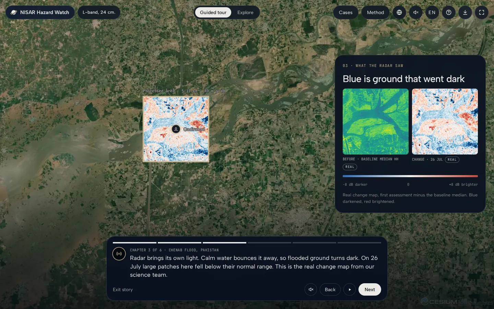

<p align="center"><b>The guided story:</b> chapter 3 of 6, the real change map from the science team, with Nova's caption bar.</p>

- **Guided story** (`/explore?story=1`; also the landing's "The Chenab flood" button, the start
  card, the "Guided tour" switch and the Help menu): six chapters on the Qadirabad (Chenab) flood.
  What happened, where, what the radar saw, the second witness, on the ground, what NISAR adds.
  Each chapter moves the globe and shows a card plus a caption bar with Back / Play / Next; Play
  advances every 9 seconds, ← → step through the chapters, Esc exits, and the last chapter's
  Explore button opens the Qadirabad case. Nova can read the captions aloud where the browser has
  a speech voice. Every number in it is the case's real report value.
- **Quick onboarding:** four spotlight steps (cases, panel, layer dock, timeline) shown once per
  browser on a plain `/explore` visit; "Seen" lives in `localStorage`. Help → "Replay the quick
  tour" shows it again; Skip or Esc closes it.
- **Nova:** a chat about the result on screen, in Plain or Technical mode, with suggested
  questions. When the backend has a Claude key (`GET /api/v1/assistant`), **Claude answers from
  the result on screen** (`POST /api/v1/assistant`, streamed) under an Experimental chip: "Answers
  by Claude from the result on screen · check numbers against the panel". Claude reads only what
  the panel, the lens card and the sheet show (`assistantContext.ts`), and the backend's prompt
  forbids causes, probabilities, hectares, displacement and invented numbers. Without a key, or
  whenever Claude fails, the **rule-based** `novaAnswer(question, context)` answers under a Demo
  chip; it only rephrases what is on screen and cites the case's sources, and questions about
  people or damage get "No data".
- **Downloads** (top bar): "Screenshot of the globe" (PNG with a strip naming the place,
  question, dates and legend, plus a Demo flag when the view has demo values), the open case's
  pass timeline as JSON or CSV (every row flagged demo, the file names its source), and "PDF
  report".
- **Report** (`/report?case=<id>`): one printable page per measured case with data blocks taken
  straight from `cases.ts` (question and verdict, the band chart, inside-versus-nearby bars,
  evidence and quality, limits, sources) and a summary filled from a fixed template, labelled
  "Not AI-written". "Save as PDF" uses the browser's print dialog. An unknown or missing case lists
  the measured ones.

**Still to fill in the story:** chapter 1's "Areas affected" and "People affected" (from the
PMD/FFD bulletin, official figures only) and chapter 5's photos and news items. They show as
bracketed slots with a To fill chip until credited, linked material is copied from its source.

## Getting started

Requirements: Node.js 20.19+ and pnpm 8.

```bash
pnpm install
pnpm dev            # http://localhost:5173
```

| Command                              | What it does                                                |
| ------------------------------------ | ----------------------------------------------------------- |
| `pnpm dev`                           | Dev server on port 5173                                     |
| `pnpm build` / `pnpm preview`        | Production build (`tsc -b && vite build`) and local preview |
| `pnpm typecheck`                     | TypeScript, strict                                          |
| `pnpm lint`                          | oxlint                                                      |
| `pnpm format` / `pnpm format:check`  | Prettier, write or check                                    |
| `pnpm test`                          | Unit tests (Vitest)                                         |
| `pnpm test:e2e` / `pnpm test:e2e:ui` | End-to-end tests (Playwright), headless or in UI mode       |
| `pnpm frames:fetch`                  | Refresh `public/data/frames.json` from the Observation Plan |

## Configuration

Names only; values live in Vercel's project settings, never in Git. One optional variable,
`VITE_API_BASE_URL`: the backend's origin when it is not served from the
same one. Vercel production sets it to the Railway backend, so browsers call it directly and the
backend's rate limit sees each user's own address (the backend allows the production origin by
CORS); previews leave it empty and use the `/api/*` rewrite of `vercel.json`, and in development
Vite proxies `/api` to `VITE_DEV_API_TARGET` (default `http://localhost:8000`). The Observation Plan and Esri imagery
need no key. Old variables such as `VITE_ENABLED_HAZARDS` or `VITE_ANALYSIS_API_URL` are unused and
can be removed from any deployment.

> [!WARNING]
> Anything named `VITE_*` is baked into the JavaScript bundle and readable by every visitor. Never
> put a secret there (an LLM API key, a token, a password). Secrets belong in a backend that the
> browser calls.

## Testing

- **Unit (Vitest):** `tests/unit/`, for pure logic: Observation Plan parsing, frame hit-testing,
  the next planned pass, timeline layout, case data rules, live-question helpers, model metrics.
- **End-to-end (Playwright):** specs in `tests/e2e/` (`site`, `cases`, `method`, `explorer`,
  and `story` for the guided story, onboarding, Nova, downloads and the report), page objects in
  `tests/e2e/pom/` (`GlobePage`, `MethodPage`), `data-testid` locators, the Observation Plan mocked
  from `tests/e2e/mocks/`. `GlobePage.skipOnboarding()` marks the quick tour as seen, as on any
  visit after the first. The live flow is covered by `live` and `search`, which mock
  `/api/v1/**` (`ExplorationMock`, a real recorded answer in `tests/fixtures/`); E2E never reaches
  a real backend.
- E2E runs against the **production build** (`pnpm build && pnpm preview`) on port 5174, or on
  `E2E_PORT` when set, with reduced motion on. Headless Chromium renders Cesium with software WebGL
  (SwiftShader), so it is slow; it uses two workers.
- **CI** (GitHub Actions, `.github/workflows/ci.yml`): lint, format check, typecheck, unit tests and
  build, then E2E, on every push to `main` and every pull request.

## Deploying

The app is a static single-page build: `pnpm build` writes `dist/`. It is hosted on Vercel at
<https://nova-frontier-frontend.vercel.app>: production deploys from `main`, and every pull request
gets a preview deployment;
`vercel.json` rewrites every path except `data/`, `cesium/` and `assets/` to `index.html`. Any
static host works with the same fallback, provided it forwards `/api/*` to the backend (or
`VITE_API_BASE_URL` points at it).

## Project structure

```text
src/
├── App.tsx            Page switch on the pathname (no router dependency)
├── pages/             landing, explorer, cases, method, about, report, and site/ (nav, footer, tokens)
├── content/           Copy (copyV8), team, data sources, NASA facts
├── features/
│   ├── cases/         Measured cases, lenses, demo band series, hazard icons
│   ├── case-panel/    Case and live-question panel: verdict, quality strip, chips
│   ├── charts/        Band chart (Recharts), contrast bars, matched whisker, metrics chart
│   ├── downloads/     Globe PNG with its context strip, timeline JSON/CSV
│   ├── frames/        Frames snapshot, hit-testing, Observation Plan client, next planned pass
│   ├── globe/         CesiumJS viewer, case markers, frame outlines, camera framing
│   ├── live/          Live question: job steps, demo answer, the frame's planned passes
│   ├── nova/          Nova chat: Claude via the backend, rule-based fallback (novaAnswer)
│   ├── onboarding/    The 4-step quick tour
│   ├── sheet/         "More information" sheet and compare tile
│   ├── story/         The guided story's chapters and cards
│   └── timeline/      Pass timeline and its layout maths
└── lib/               Navigation, async state, provenance chip, shared helpers
public/                frames.json, case crops and figures, landing, footer and team pictures
scripts/               Frames snapshot generator
tests/                 Unit (Vitest) and E2E (Playwright, page objects, mocks)
docs/architecture/     Architecture diagram (HTML source and PNG)
assets/readme/         README pictures (WebP)
```

## What we don't claim

The app shows measured radar evidence and says what it can't tell. It never shows a forecast, a
probability, a cause stated as a result, "detected", hectares or flooded area, flood depth, or
centimetres of ground motion from coherence. Every number carries its dates, polarization and
denominator ("N of M analysis cells") and a chip: **Real**, **Demo**, **To fill**, **Hypothesis** or
**Experimental**; only Real chips can be hidden. "No measurement" stays grey and gaps stay gaps. A
planned pass is a promise, not data. Nova answers only about the result on screen and says "No
data" about people or damage. Team decisions behind these rules:
[`docs/design/README.md`](docs/design/README.md).

## Branches, pull requests and protection

- Branch from an up-to-date `main` (`feat/…`, `fix/…`, `docs/…`), one branch per issue.
- Open a pull request into `main`. The **Protect main** ruleset requires the
  **"Lint, typecheck, unit tests, build"** check and blocks force-pushes and deletion; the **Review
  main** ruleset requires one approving review. E2E runs on the pull request too.
- Vercel builds a preview of every pull request; merging to `main` deploys production.

## Contributing

- **Conventional commits** (`feat:`, `fix:`, `docs:`, …), enforced by commitlint. Husky and
  lint-staged run oxlint and Prettier before each commit.
- **TypeScript strict** with `noUncheckedIndexedAccess` and `exactOptionalPropertyTypes`; named
  exports; `@/` imports; comments say _why_, not _what_.
- Every async view handles loading, error (with retry) and empty states.
- Project conventions for people and AI agents: [`CLAUDE.md`](CLAUDE.md). Visual system:
  [`DESIGN.md`](DESIGN.md).

## Credits and license

- **NASA-ISRO NISAR** L2 GCOV and GUNW products, via the
  [Alaska Satellite Facility DAAC](https://search.asf.alaska.edu/).
- **NASA NISAR Observation Plan** (frames and passes).
- **NASA JPL OPERA** DSWx-HLS and DIST-ALERT (the optical second witness in the science reports).
- **NASA FIRMS** active-fire detections (wildfire context, through the backend) and
  **OpenStreetMap Nominatim** place search (© OpenStreetMap contributors, shown in the app).
- Backend and models: [nova-frontier-backend](https://github.com/NASA-NOVA-FRONTIER/nova-frontier-backend),
  [nova-frontier-model](https://github.com/NASA-NOVA-FRONTIER/nova-frontier-model) and
  NISAR-Models (`Ch0comilo/NISAR-Models`, not public on 2026-11-15; see #13).
- Landing pictures: NISAR's first image of North Dakota and the artist's concept of NISAR
  (NASA/JPL-Caltech); Blue Marble and cloud imagery (NASA Visible Earth), all public domain.
  Optical view: NASA HLS, contains modified Copernicus Sentinel-2 data (2025), via NASA Worldview.
- Base imagery © Esri, Maxar, Earthstar Geographics. Globe by
  [CesiumJS](https://cesium.com/platform/cesiumjs/).
- Pass timeline's next-planned-pass idea: Katheryn Guasca.
- **License:** TODO (owner: team). This repository has no `LICENSE` file yet; each data product
  keeps its own terms.

Built by team **Nova Frontier** for the **NASA International Space Apps Challenge 2026**.
